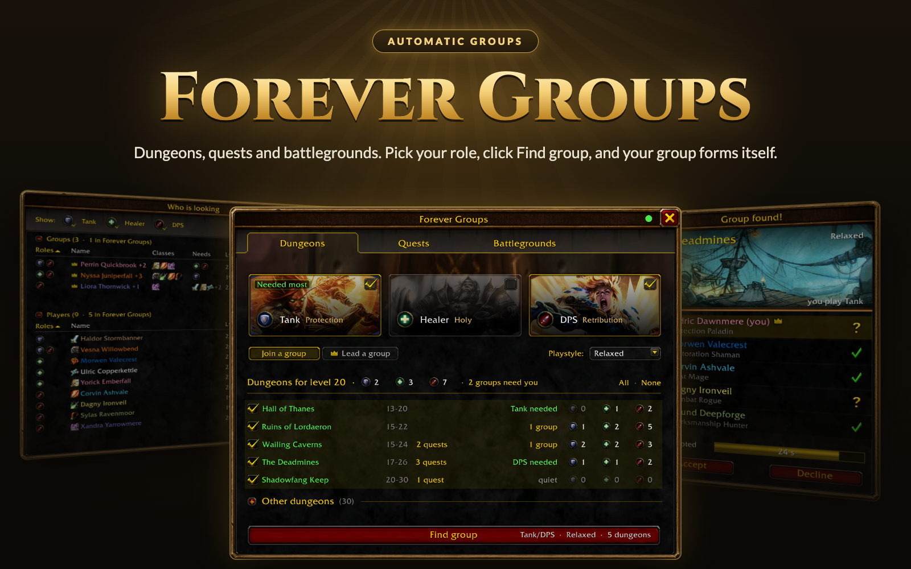
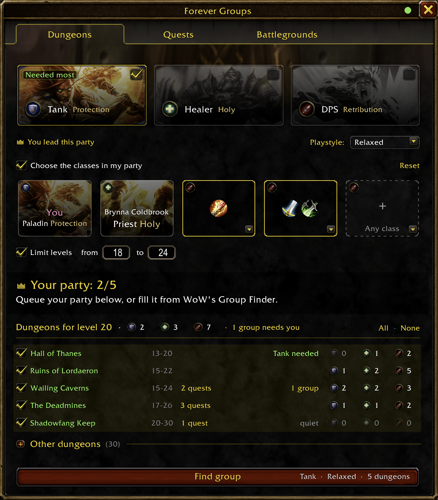
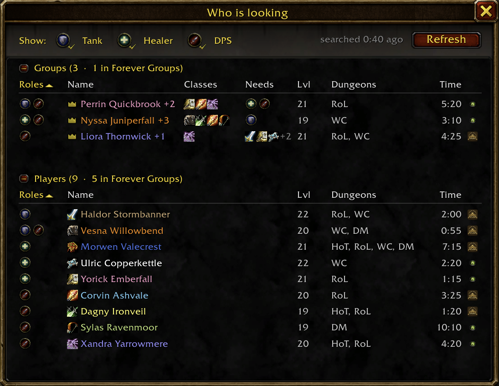
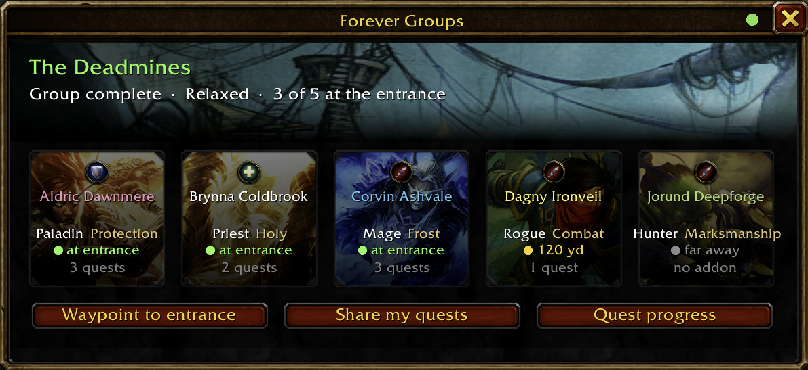

# Forever Groups

**Pick a role, get a group.** Dungeons, group quests and battlegrounds on WoW Forever, without the waiting and the chat spam.

## Find a group in one click

- Tick your roles and dungeons, press **Find group**, accept the popup. That's it.
- Players are invited for you and everyone's role is set.
- Works with everyone in WoW's Group Finder, so other players don't need the addon.
- Dungeons, group quests and battlegrounds, even all three at once.

## Lead your own group

- **Lead a group** and it's built around you.
- **Choose the classes** you want: a Mage for water, a Warrior to tank.
- **Limit levels** to players close to yours.

## See who is looking

- Every player and group looking for the same dungeon, with their roles, classes and level.
- Right-click to whisper, invite or ask to join.

## In the group

- Everyone's role, spec and distance to the entrance, plus a waypoint.
- Your dungeon quests are shared with whoever is missing them.
- Boss progress and everyone's quest progress at a glance.
- Someone left? A replacement is found in one click.

## And more

- Playstyles: Learning, Relaxed, Competitive or Carry Offered.
- English, German, Spanish and Russian.
- Every message it sends can be rewritten in your own words.

**Open it with `/fg`**, the minimap button or the Forever Groups tab on WoW's Group Finder.

Found a bug or have an idea? Open an issue on GitHub and paste the text from `/fg bugreport`.
