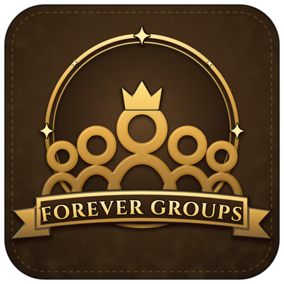
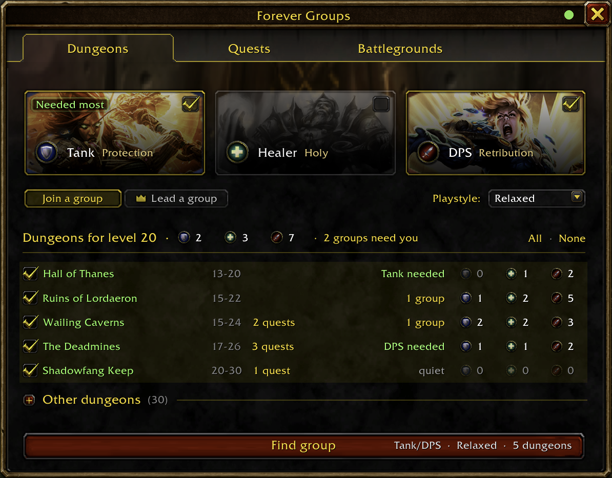
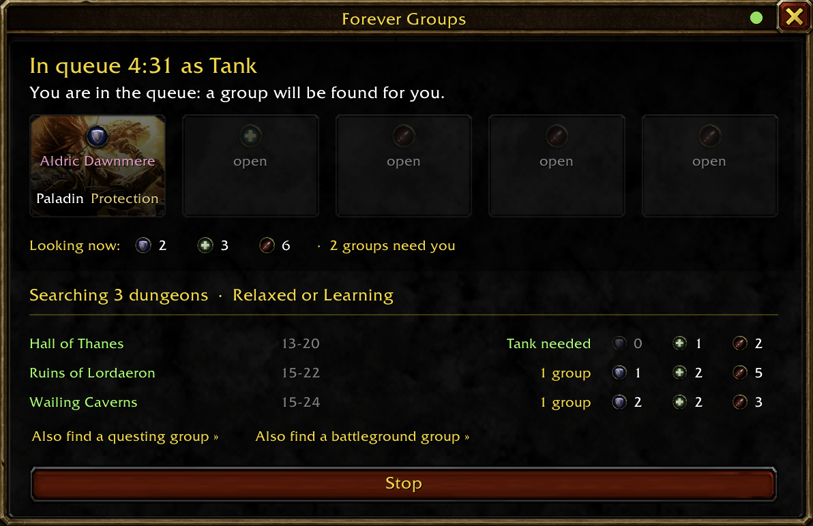
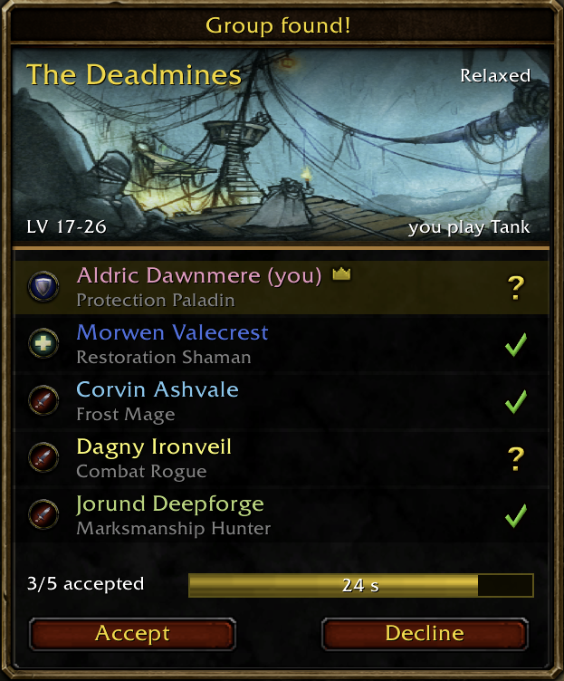
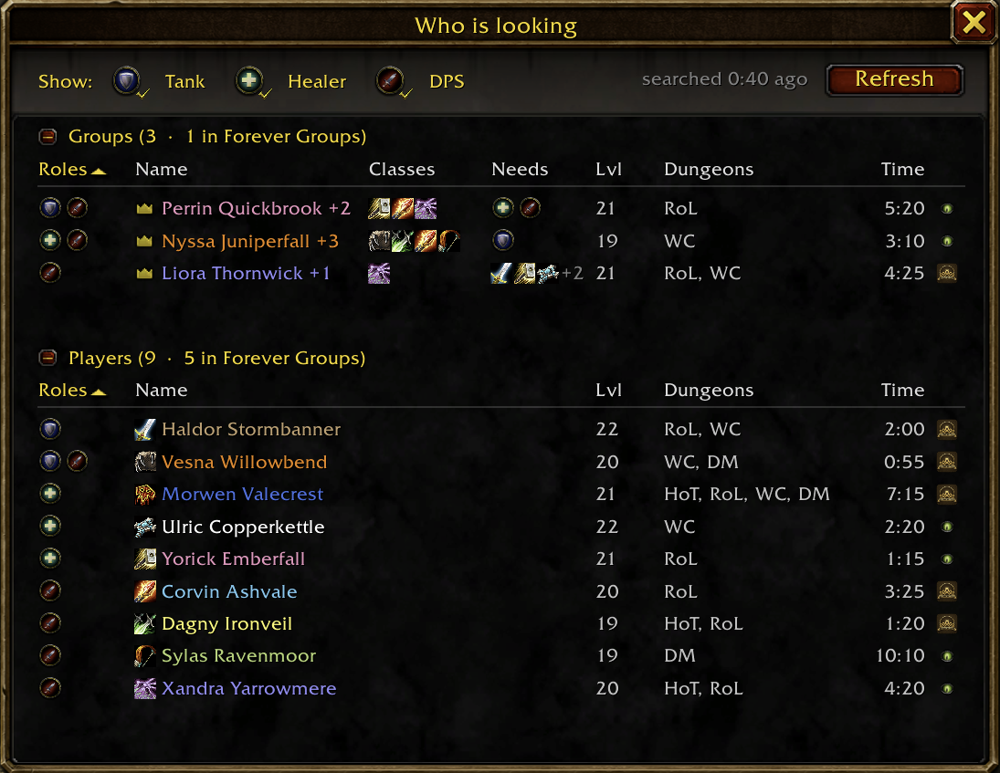
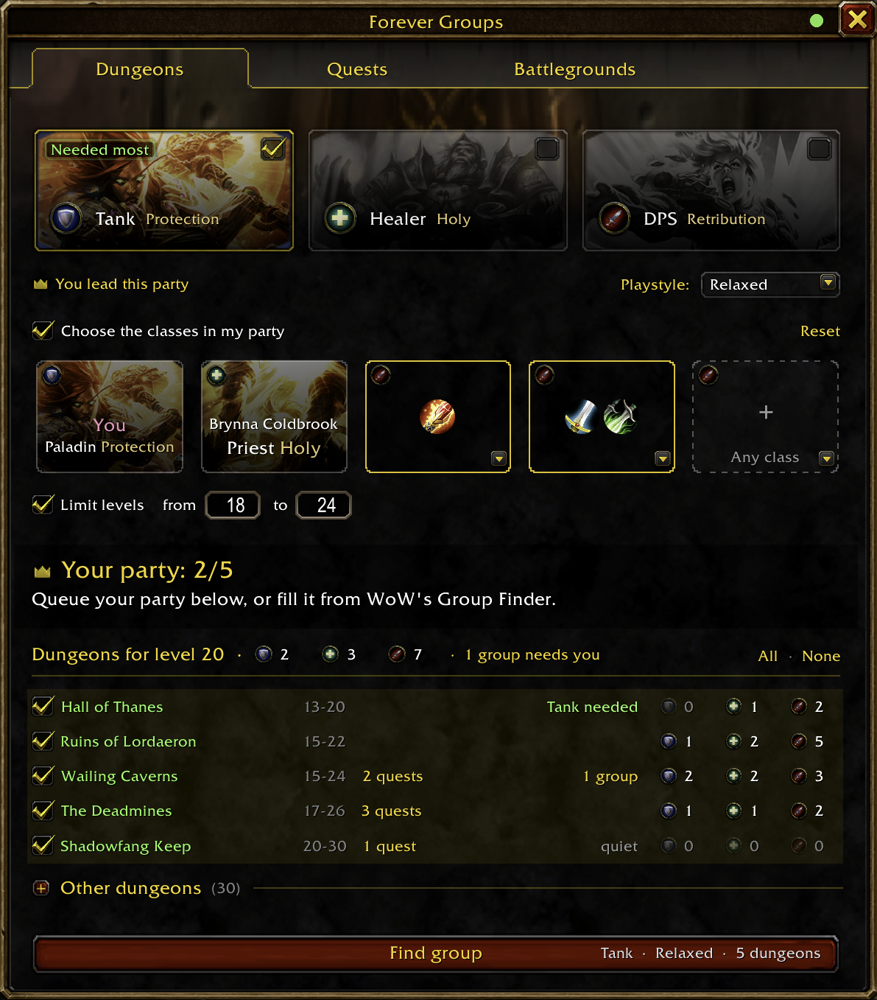
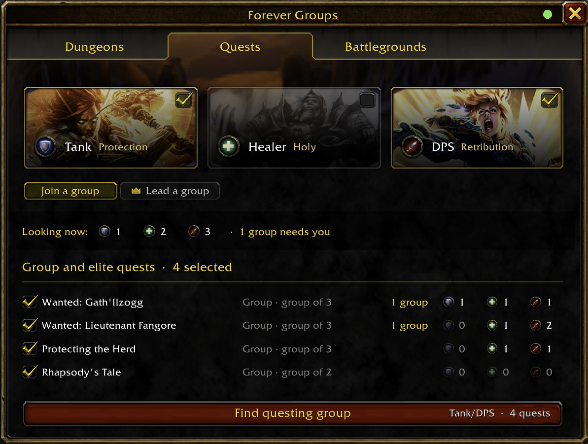
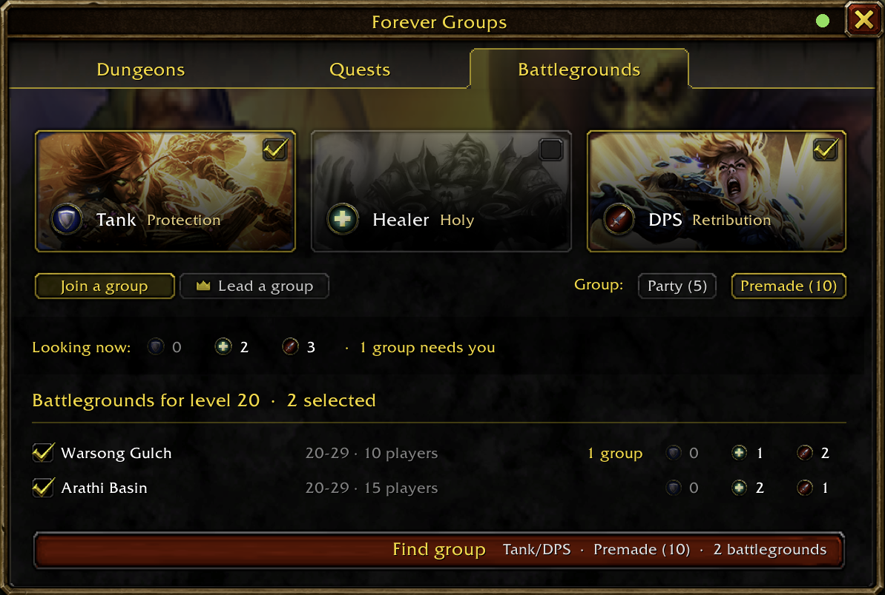
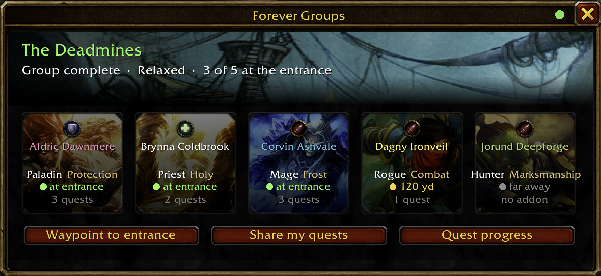
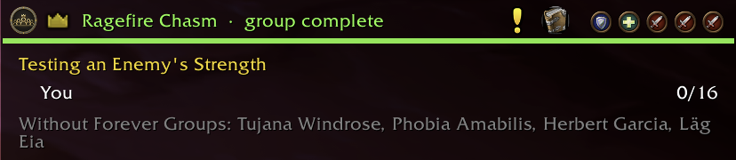

# Forever Groups

**Automatic groups for dungeons and group quests on WoW Forever: pick a role, get a group.**

Tick the roles you can play, choose your dungeons or group quests and press **Find group**.
When a group is found, everyone gets a short popup to accept; once all have accepted you're
in the group, with roles set for you.

  
  
  
  

## What it does

- **Dungeons** — queue for one or more dungeons that fit your level, solo or with your party.
- **Group quests** — a Quests tab with the group and elite quests in your quest log; hover one for its
  objectives, right-click it to open it in your quest log.
- **Battlegrounds** (beta) — a Battlegrounds tab for Warsong Gulch, Arathi Basin and Darkspear Islands
  in your level bracket: who is looking, and Find group to team up with other Forever Groups
  players, join a group listed in WoW's Group Finder, or build a party of five or a premade of
  ten (a raid, with at least two healers) from listed players. Sign up at a battlemaster as a
  group. You can wait for a dungeon, a quest and a battleground at the same time.
- **Join or lead** — "Join a group" finds you a group; with "Lead a group" you become the leader
  of the group that forms, and Forever Groups builds it for you.
- **Playstyle** — "Any" by default, so you're grouped with everyone; pick Learning, Relaxed,
  Competitive or Carry Offered in the dropdown under the role tiles to be grouped with
  like-minded players only.
- **Your language** — like WoW's Group Finder, you're grouped with players whose game is in your
  language; tick more languages in Settings → Groups to be grouped with those players too. That
  holds while other Group Finder addons search too: their results in other languages stay out.
- **Uses WoW's Group Finder too** — invites solo players listed for your dungeon, asks listed
  groups to invite you (and joins when they do, as the role they still need), lists your own
  group, and invites players who whisper a needed role. The first 5 minutes of building a group
  it invites no second of a class for the same role and no third of a class (a setting), and after
  that still another class first when there is one; groups of Forever Groups players from the
  queue follow the same rule. Of the players who fit, those closest to the group's level go first.
- **One screen** — the window looks the same while you choose, wait and play: your roles stay
  on screen while you wait (press Stop to change them), and the group's five places show under
  them as they fill.
- **In the group** — every member's role, spec, distance to the entrance and dungeon quests in
  the group's places; your quests for the dungeon are shared by themselves with whoever lacks
  them (or in one click); a waypoint to the entrance.
  When someone leaves, one click (or none, a setting) finds a replacement; click the open place first
  to choose its classes, or "End run" to stop following the group without leaving it. If your leader doesn't
  have Forever Groups and the group isn't full yet, "Make me leader" asks them to promote you;
  then Forever Groups fills the group.
- **Your role in demand** — each dungeon shows how many listed groups need you, and "Tank needed"
  when too few others looking can play your role; the role tile needed most says so.
- **Disconnected?** Back within 15 minutes and you're in the queue again.
- **Status bar** — boss progress (e.g. 4/7 bosses) and everyone's quest progress, folded out
  under the bar.
- **Limit levels** — leading, set the lowest and highest level of the players who join you.
- **Choose the classes in your party** — leading a dungeon group, switch it on and pick the
  classes you want per place (a Mage for water, a Warrior to tank); only those classes join you.
- **Who is looking** — a drawer on the side of the window with the players and groups looking
  for your dungeons or group quests, from Forever Groups and WoW's Group Finder (Quests & Zones
  for quests); right-click to whisper, invite or request to join. Filter boxes on top show only the
  players of the roles and classes you want, groups that need a role or have room for your
  class, and players or groups near your level. Open by default; the tab with the eye on the window's edge
  opens and closes it.
- **Your own words** — every whisper and party message can be rewritten (any language) or
  turned off. The whispers it sends for you stay out of your own chat; answers always show.
- **In your language** — English, German, Spanish and Russian, following your WoW client (or
  pick one in Settings → Display).
  Whispers to other players stay English, so everyone can read them.

  
  
  

  
  

Forever Groups players share one queue through a hidden addon channel. There are no
servers or websites involved; everything happens in game.

## Getting started

1. Install the addon (CurseForge, Wago or WoWInterface) and log in. The first time, the window opens by itself
   with a welcome, and shows every screen once with example data, explained step by step.
2. Later, type `/fg`, click the minimap button, or the Forever Groups tab on WoW's Group Finder.
3. Tick your roles and dungeons (or open the **Quests** tab) and press **Find group**.

## Commands

| Command | What it does |
|---|---|
| `/fg` | Open the window |
| `/fg queue` | Open Who is looking |
| `/fg settings` | Settings: Groups, Messages, Display |
| `/fg messages` | Edit the whispers and party messages |
| `/fg progress` | Fold the quest progress in or out |
| `/fg demo` | Walk through every screen with example data (also under Settings → Display) |
| `/fg help` | All commands |
| `/fg selftest` | Check which game features work in your client |
| `/fg bugreport` | A report to copy when something goes wrong |
| `/fg debug on` | Show in chat everything Forever Groups does for you (`/fg debug off` to hide it again) |

## Questions

**Do the other players need the addon?**
No. Forever Groups also finds and invites players through WoW's own Group Finder. Players
with the addon get matched with each other directly, so the more people use it, the faster
groups form.

**What does it send on my behalf?**
A short whisper before inviting someone from the Group Finder, a question to a group leader
when asking to be invited, and (as leader) a line in party chat when the group is complete.
It only contacts players listed for the same dungeon or quest, asks one group leader at a
time (the next after 20 seconds without an invite, or at once when the leader says no or the
group fills up), recently listed groups first, and doesn't ask the same leader again for 15
minutes. When a leader you asked invites you, you join right away (a setting). If a leader
asks back for your level, class or spec, Forever Groups answers for you. You can change or turn
off every message. None of this shows in your chat: you just see "Looking for a group" and then
your group. Type `/fg debug on` to see everything it does.

**Can I use it without WoW's Group Finder?**
Yes: turn off "Use WoW's Group Finder" in the settings. Forever Groups then only works with
other Forever Groups players.

## Feedback

Found a bug or have an idea? [Open an issue](https://github.com/julianklumpers/wow-forever-groups/issues)
and paste the text from `/fg bugreport`.

## Credits

Dungeon entrance positions are based on the ForeverDungeonJournal addon by Exehn; the
directions are our own. Boss counts per dungeon (rare spawns left out) are based on its boss
lists.

The minimap button uses LibDBIcon-1.0, LibDataBroker-1.1, CallbackHandler-1.0 and LibStub,
bundled in `libs/` (authors and licenses in `libs/README.md`).

For developers: how it works inside, tests and releases are in
[docs/DEVELOPMENT.md](docs/DEVELOPMENT.md).

## License

[MIT](LICENSE)
