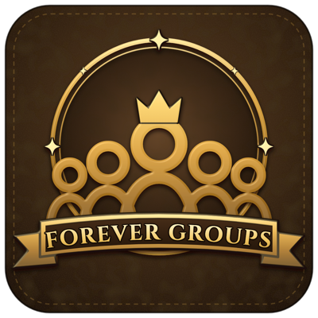
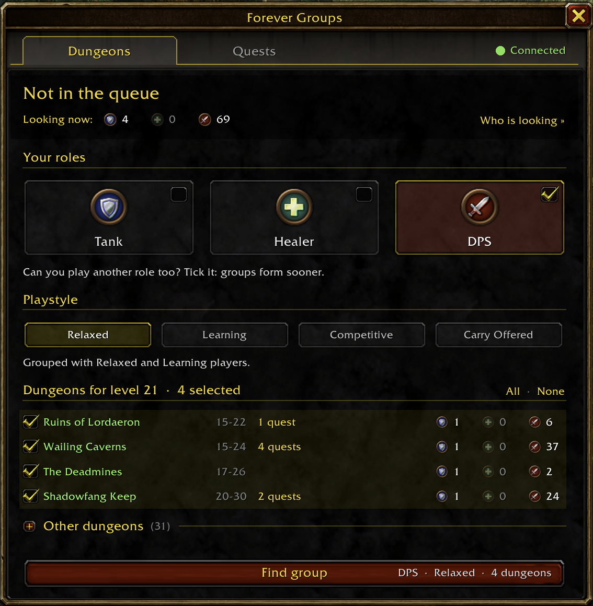
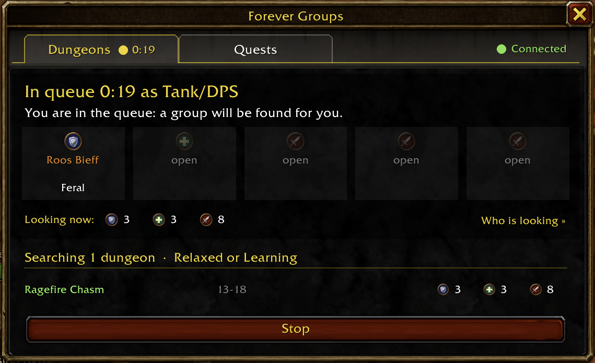
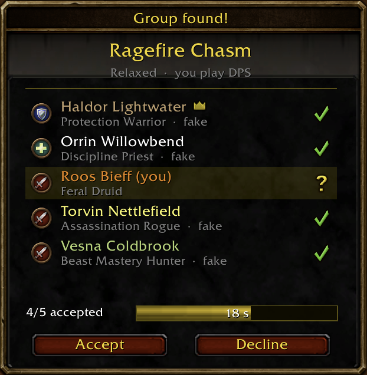
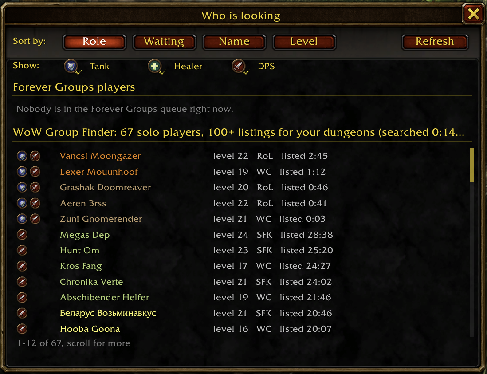
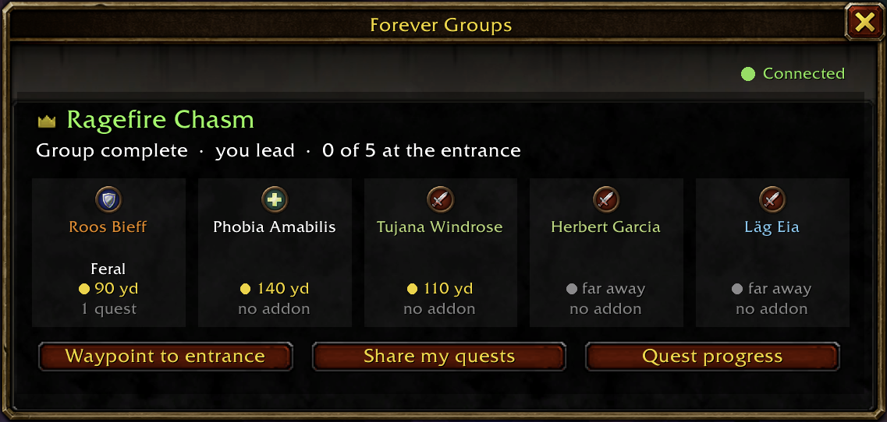
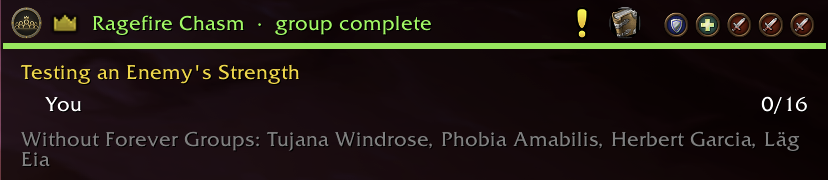

# Forever Groups

**Automatic groups for dungeons and group quests on WoW Forever: pick a role, get a group.**

Tick the roles you can play, choose your dungeons or group quests and press **Find group**.
When a group is found, everyone gets a short popup to accept; once all have accepted you're
in the group, with roles set for you.

  
  
  
  

## What it does

- **Dungeons** — queue for one or more dungeons that fit your level, solo or with your party.
- **Group quests** — a Quests tab with the group and elite quests in your quest log.
- **Lead if you like** — turn on "Lead the group" and you become the leader of the group that
  forms; Forever Groups builds it for you.
- **Playstyle** — Learning, Relaxed, Competitive or Carry Offered; you're grouped with
  like-minded players.
- **Uses WoW's Group Finder too** — invites solo players listed for your dungeon, asks listed
  groups to invite you, lists your own group, and invites players who whisper a needed role.
- **In the group** — a card with every member's role, spec, distance to the entrance and
  dungeon quests; share your quests in one click; a waypoint to the entrance.
- **Status bar** — boss progress (e.g. 4/7 bosses) and everyone's quest progress, folded out
  under the bar.
- **Who is looking** — a table of players and groups looking for your dungeons, sortable by
  column; right-click to whisper, invite or request to join.
- **Your own words** — every whisper and party message can be rewritten (any language) or
  turned off.

  
  

Forever Groups players share one queue through a hidden addon channel. There are no
servers or websites involved; everything happens in game.

## Getting started

1. Install the addon (CurseForge, Wago or WoWInterface) and log in.
2. Type `/fg` or click the minimap button.
3. Tick your roles and dungeons (or open the **Quests** tab) and press **Find group**.

## Commands

| Command | What it does |
|---|---|
| `/fg` | Open the window |
| `/fg queue` | Who is looking |
| `/fg settings` | Settings: Groups, Messages, Display |
| `/fg messages` | Edit the whispers and party messages |
| `/fg progress` | Fold the quest progress in or out |
| `/fg help` | All commands |
| `/fg selftest` | Check which game features work in your client |
| `/fg bugreport` | A report to copy when something goes wrong |

## Questions

**Do the other players need the addon?**
No. Forever Groups also finds and invites players through WoW's own Group Finder. Players
with the addon get matched with each other directly, so the more people use it, the faster
groups form.

**What does it send on my behalf?**
A short whisper before inviting someone from the Group Finder, a question to a group leader
when asking to be invited, and (as leader) a line in party chat when the group is complete.
It only contacts players listed for the same dungeon or quest, asks at most three leaders at a
time and never the same player twice. You can change or turn off every message.

**Can I use it without WoW's Group Finder?**
Yes: turn off "Use WoW's Group Finder" in the settings. Forever Groups then only works with
other Forever Groups players.

## Feedback

Found a bug or have an idea? [Open an issue](https://github.com/julianklumpers/wow-forever-groups/issues)
and paste the text from `/fg bugreport`.

## Credits

Dungeon entrance positions are based on the ForeverDungeonJournal addon by Exehn; the
directions are our own. Boss counts per dungeon (rare spawns left out) are based on its boss
lists.

For developers: how it works inside, tests and releases are in
[docs/DEVELOPMENT.md](docs/DEVELOPMENT.md).

## License

[MIT](LICENSE)
